<h1 align="center">Draw beautiful</h1>

<p align="center">
  <a href="https://code.claude.com/docs/en/skills"></a>
  <a href="https://agentskills.io"></a>
  <a href="#requirements"></a>
</p>

<p align="center">
  <a href="#quick-start">Quick start</a> ·
  <a href="#gallery">Gallery</a> ·
  <a href="#what-it-makes">What it makes</a> ·
  <a href="#install">Install</a> ·
  <a href="#examples">Examples</a> ·
  <a href="#how-it-works">How it works</a> ·
  <a href="#requirements">Requirements</a> ·
  <a href="#license">License</a>
</p>

---

Ask Claude for an engraving and Draw beautiful builds the subject as real surfaces in 3D, lights it with one sun, casts true shadows, and engraves the result as swelling burin lines: contour hatching that follows the form, cross-hatching in the darks, a ruled sky that stops short of the subject. It frames the picture as a bank-note plate with a guilloche border and a lettered title tablet, then makes it move calmly. The sun crosses the sky, or a part turns.

Nothing is filled with grey. The kit measures how dark each point is and turns that into line width, so the shading is true to the light.

It is the sibling of [`/anatomy`](https://github.com/wheresryan22/anatomy): the same rules for what to draw, rendered as an engraving instead of flat isometric shading.

## Quick start

```sh
npx skills add bumicodes/draw-beautiful -g -a claude-code
```

Then, in Claude Code:

```text
/draw-beautiful an engraved lighthouse on a rocky point, the beam sweeping at dusk
```

No API keys and nothing to `npm install`. The kit uses only Node's built-in modules.

### Prompts to try

Describe the thing, where it stands and what moves. The skill picks the size, the light and the line systems.

```text
/draw-beautiful a brass pocket watch lying open on a velvet cloth, the second hand ticking
/draw-beautiful a stone well in a village square, its shadow turning through the afternoon
/draw-beautiful a nautilus shell cut in half to show its chambers, lit from the upper left
/draw-beautiful the Eiffel Tower from the Champ de Mars, the sun crossing a summer sky
/draw-beautiful a steam locomotive on a viaduct, its wheels turning, as a bank-note vignette
```

### From a reference image

Give it a photograph, drawing or postcard and it fits the camera and the proportions to it, then engraves the model. The sun can still move. Pass the image path or paste the image into the prompt.

```text
/draw-beautiful engrave this photo of my grandparents' house ~/Pictures/house.jpg
/draw-beautiful ./refs/bridge-1905.png the old bridge as an engraving, keep the photo's camera and light
/draw-beautiful this postcard of Madras Central ./madras.png, invent what the trees hide and let the clocks keep time
```

It saves the image as `reference.png` beside the scene and adds an `--overlay` flag to the build, which draws the photo under the art so you can check that they line up (see [`madras`](examples/madras)).

## Gallery

<table>
  <tr>
    <td width="50%">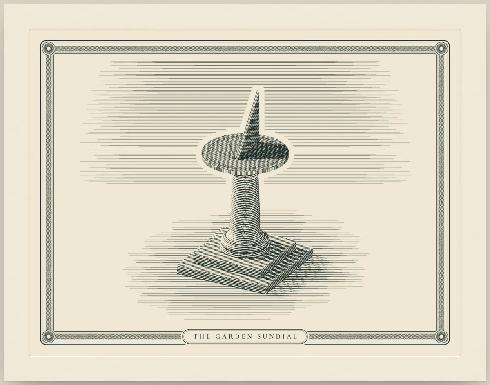</td>
    <td width="50%">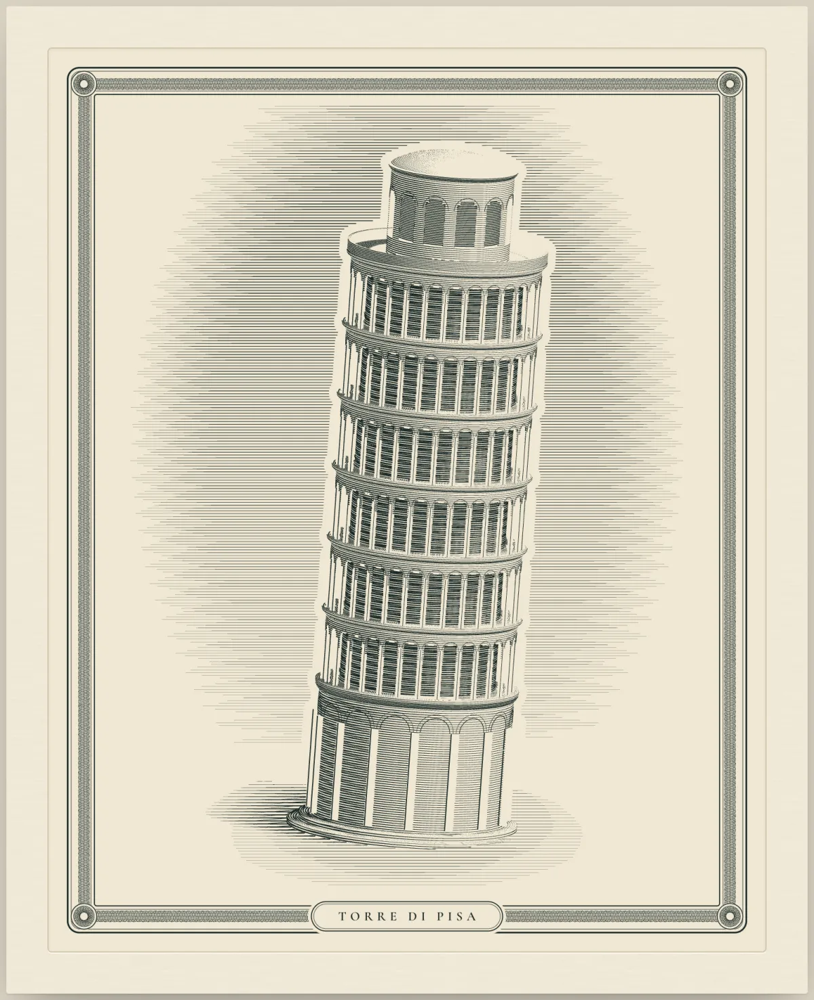</td>
  </tr>
  <tr>
    <td><sub><b>sundial</b>: the sun moves through the day and the gnomon's shadow, from a real shadow map, lands on hour lines drawn from tan θ = sin φ · tan H.</sub></td>
    <td><sub><b>pisa</b>: the tower at its real proportions and 3.97° lean, 30 columns per gallery with arched openings cut through the surface. Its shadow sweeps the lawn as the sun crosses Pisa's sky.</sub></td>
  </tr>
  <tr>
    <td>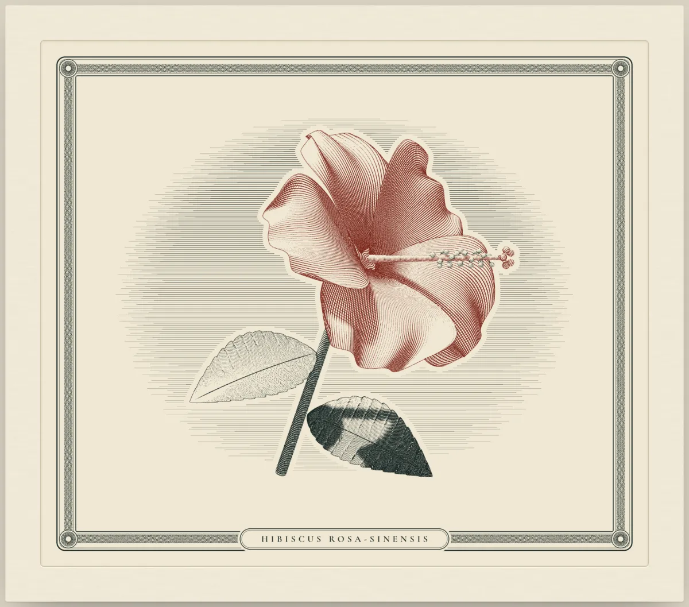</td>
    <td>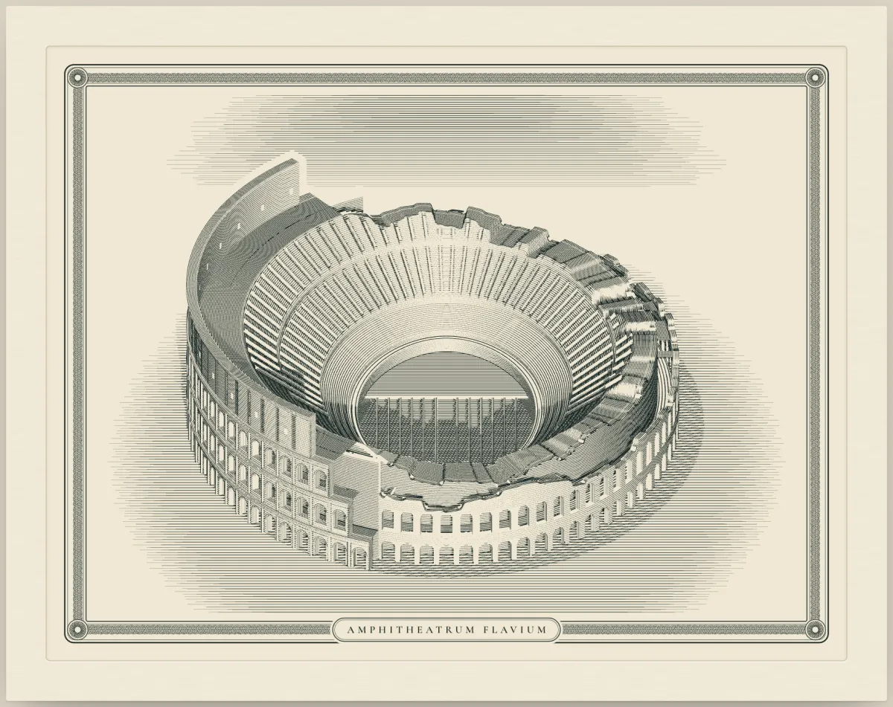</td>
  </tr>
  <tr>
    <td><sub><b>hibiscus</b>: an organic vignette in two inks. Petals and leaves are thin two-sided sheets, and every part casts on the others as the light swings round.</sub></td>
    <td><sub><b>colosseum</b>: the amphitheatre as it stands, 188 × 156 m with 80 bays, seen on 21 April, Rome's birthday. The outer ring survives only to the north, and the hypogeum shows where the arena floor is gone.</sub></td>
  </tr>
  <tr>
    <td>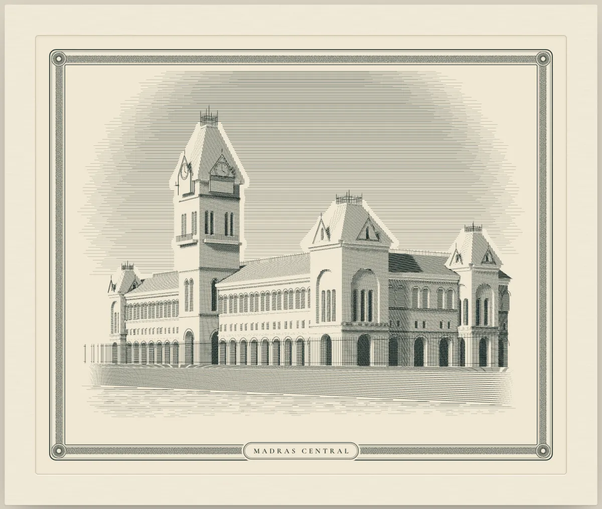</td>
    <td>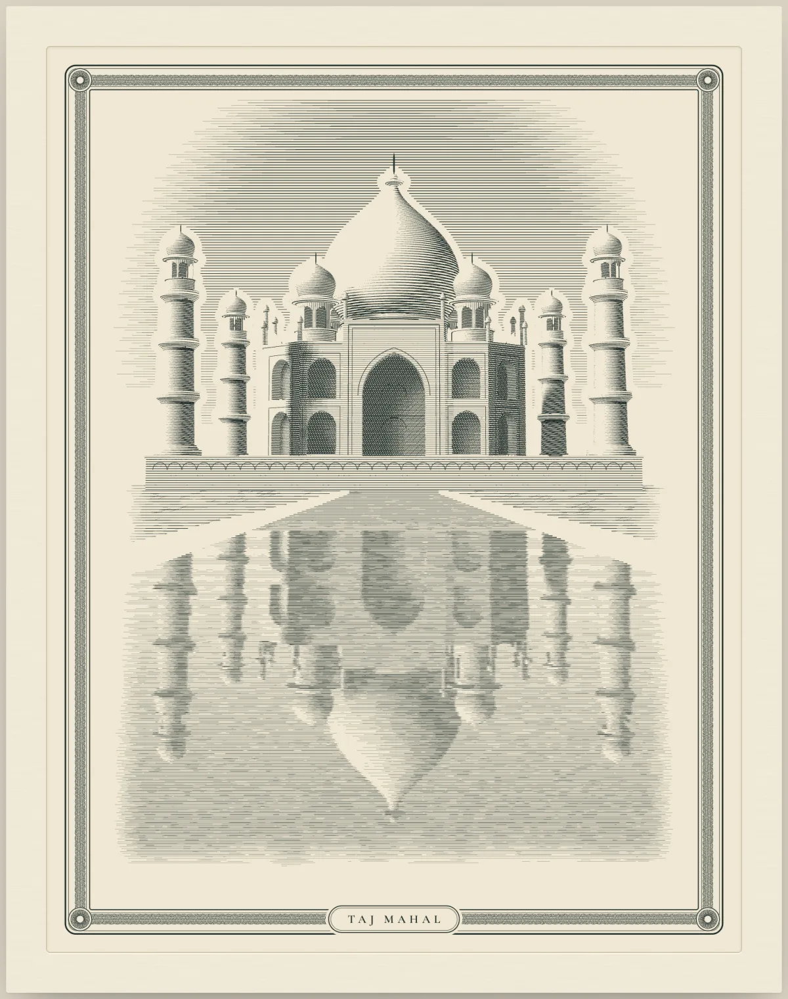</td>
  </tr>
  <tr>
    <td><sub><b>madras</b>: the station built from a photograph of about 1880. The camera is fitted to landmarks measured on the photo, and the sun follows Madras's sky through a day in mid-October.</sub></td>
    <td><sub><b>taj</b>: the tomb at its real proportions, seen from the canal's end through a perspective camera. The reflection is ray-cast through the mirrored eye, and the iwans' shadows turn as the sun crosses Agra's sky.</sub></td>
  </tr>
  <tr>
    <td>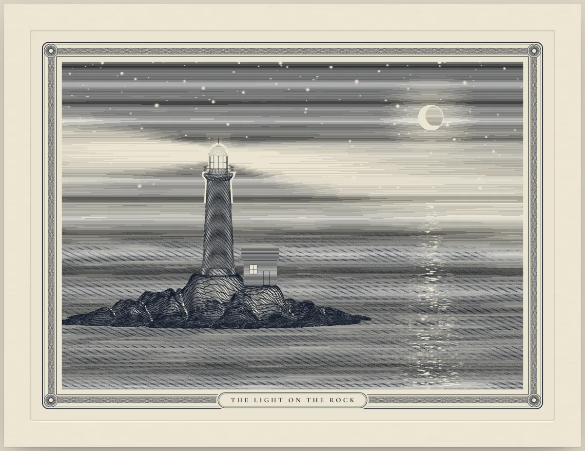</td>
    <td>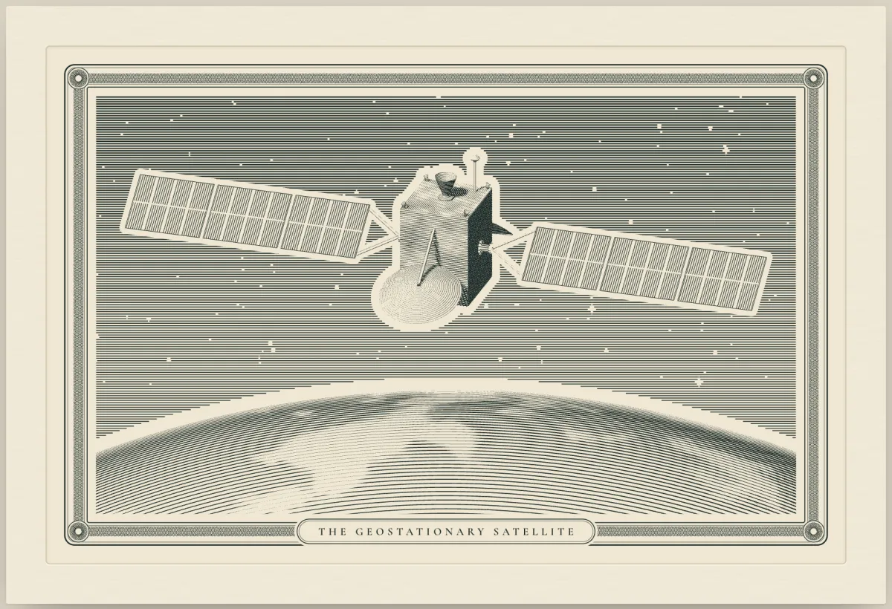</td>
  </tr>
  <tr>
    <td><sub><b>lighthouse</b>: a night plate rimmed by a low moon. The lamp turns two beams, and every line seen through a beam is thinned, so each beam cuts a bright wedge through sky, sea and rock.</sub></td>
    <td><sub><b>satellite</b>: a geostationary satellite over the Earth's limb. Its wings turn 15° an hour to face the sun while the bus, the reflectors and the Earth below pass from day into night.</sub></td>
  </tr>
  <tr>
    <td>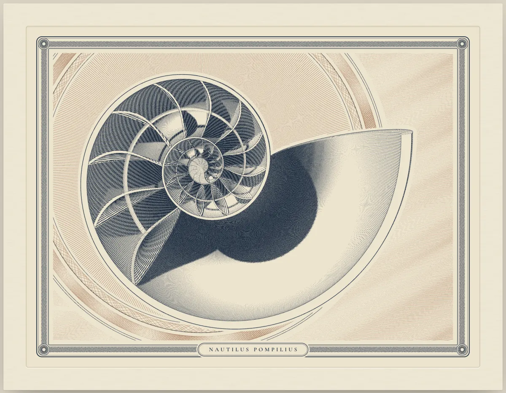</td>
    <td>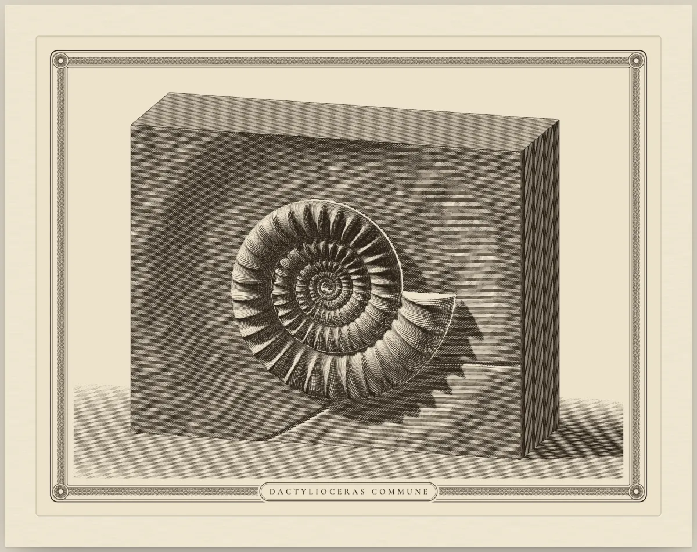</td>
  </tr>
  <tr>
    <td><sub><b>nautilus</b>: a logarithmic spiral that triples its radius every whorl, sawn through so you look into every chamber. A lamp sweeps the face, the shadows wheel inside the chambers and a glint travels over the nacre.</sub></td>
    <td><sub><b>ammonite</b>: an evolute spiral fossil in a block of limestone, in sepia. A low light circles the face, so the ribs throw their shadows each way in turn and the block's shadow swings over the ground.</sub></td>
  </tr>
  <tr>
    <td>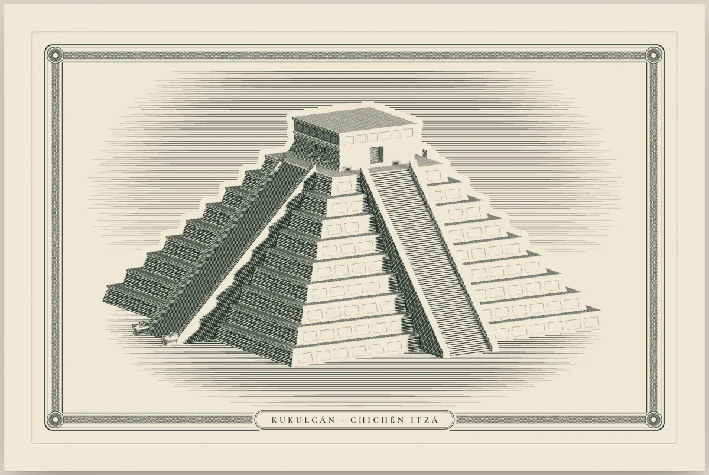</td>
    <td>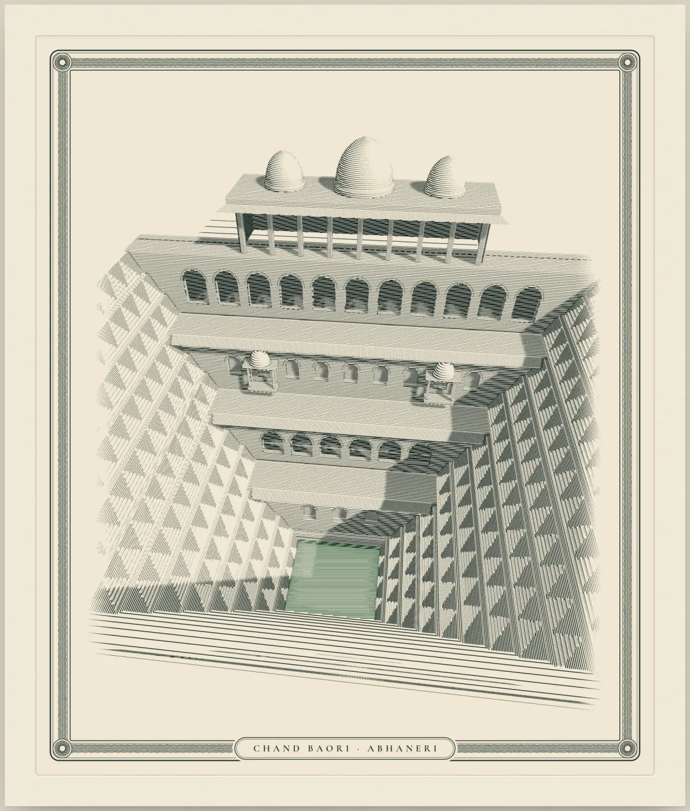</td>
  </tr>
  <tr>
    <td><sub><b>kukulcan</b>: El Castillo on the spring equinox, turned 17° off the compass as it stands. Late in the afternoon the terrace corners cast a sawtooth of light down the north stair's balustrade, the serpent coming down to its carved head, straight from the shadow map.</sub></td>
    <td><sub><b>chandbaori</b>: the Abhaneri stepwell from its rim, 13 storeys of zigzag steps built down to every tread, falling 20 m to the water. The rim's shadow and each step's own shadow sweep the terraces through a day at 27° N.</sub></td>
  </tr>
  <tr>
    <td colspan="2">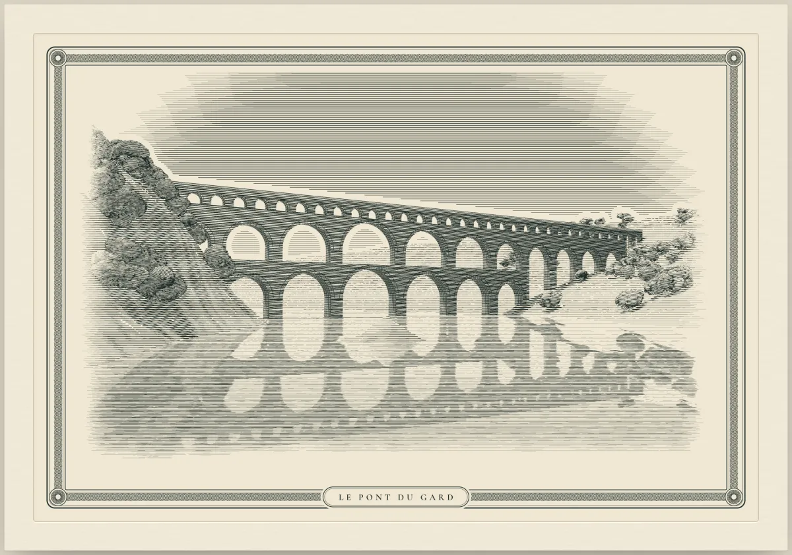</td>
  </tr>
  <tr>
    <td colspan="2"><sub><b>pontdugard</b>: the aqueduct at its real dimensions, 6, 11 and 35 arches in three tiers, 49 m over the Gardon. The sun crosses a summer sky at 43.9° N, each arch's shadow turns and the arches are mirrored in the river.</sub></td>
  </tr>
</table>

Every screenshot is the light plate of a page in [`examples/`](examples), captured with the skill's own [`scripts/capture.mjs`](scripts/capture.mjs). Build any example (below) and open its `.html` to see it move.

## What it makes

| Size | What it is | Example |
|---|---|---|
| **Vignette** | One object on a plinth or a patch of ground, 5–15 surfaces, one sun. | `sundial`, `hibiscus`, `ammonite` |
| **Scene** | Several objects, architecture, a landscape or a mechanism that moves. | `pisa`, `colosseum`, `taj` |
| **Plate** | A full bank-note composition: portrait, lettering, guilloche frame, several inks. The skill builds the vignette at its heart first, then lists what the full plate adds. | none yet |

Each figure ships in a light plate (dark ink on cream paper) and a dark one, a true white-line negative that inks the light instead of inverting the colours. Pages are standalone HTML with the first frame rendered at build time, so they paint at once. The scene module also drops into React.

## Install

Draw beautiful is a standard [Agent Skill](https://code.claude.com/docs/en/skills): a folder with a `SKILL.md` at its root. This repository is that folder.

| Method | Command | Installs to |
|---|---|---|
| **skills CLI** | `npx skills add bumicodes/draw-beautiful -g -a claude-code` | `~/.claude/skills/draw-beautiful` |
| **git**, for you | `git clone https://github.com/bumicodes/draw-beautiful.git ~/.claude/skills/draw-beautiful` | `~/.claude/skills/draw-beautiful` |
| **git**, for one project | `git clone https://github.com/bumicodes/draw-beautiful.git .claude/skills/draw-beautiful` | `.claude/skills/draw-beautiful` |

## Examples

Each example is a `scene.mjs` (the model and the surfaces) and a `build.mjs` that writes standalone pages next to itself. Add `--dark` for the dark plate.

| Example | What it shows | Build |
|---|---|---|
| [`sundial`](examples/sundial) | A garden sundial on a turned stone pedestal. The smallest example: read its `scene.mjs` first, it uses every part of the kit. | `node examples/sundial/build.mjs` |
| [`pisa`](examples/pisa) | The Leaning Tower with six arcaded galleries and its shadow on the lawn. The reference for architecture and masked openings. | `node examples/pisa/build.mjs` |
| [`hibiscus`](examples/hibiscus) | A flower in two inks, built from ruffled sheet surfaces. The reference for organic forms. | `node examples/hibiscus/build.mjs` |
| [`taj`](examples/taj) | The Taj Mahal from the end of its canal, its reflection ray-cast in the water. The reference for the perspective camera and recessed arched openings. | `node examples/taj/build.mjs` |
| [`madras`](examples/madras) | Madras Central station built from a photograph of about 1880 (`reference.png`): camera and masses fitted to landmarks on the photo, checked against it with `--overlay`, its clocks keeping the hour as the sun crosses. The reference for drawing from an image. | `node examples/madras/build.mjs` |
| [`colosseum`](examples/colosseum) | The Colosseum as it stands, its broken rings and open hypogeum, under Rome's sky on 21 April. The reference for ruins and for building in metres from real dimensions. | `node examples/colosseum/build.mjs` |
| [`lighthouse`](examples/lighthouse) | A lighthouse on a rock at night, its two beams thinning every line they pass in front of. The reference for night plates and light in the air. | `node examples/lighthouse/build.mjs` |
| [`nautilus`](examples/nautilus) | A chambered nautilus sawn in half on a bank-note medallion, a lamp sweeping its cut face. The reference for cavities and a second ink for the ground. | `node examples/nautilus/build.mjs` |
| [`ammonite`](examples/ammonite) | An ammonite in a limestone block under a low light circling round it. The reference for relief on a face and raking light. | `node examples/ammonite/build.mjs` |
| [`satellite`](examples/satellite) | A geostationary satellite whose wings track the sun through a day over the Earth's limb. The reference for moving parts on a lit body and night-side shading. | `node examples/satellite/build.mjs` |
| [`kukulcan`](examples/kukulcan) | El Castillo at Chichén Itzá on the spring equinox: nine terraces, four stairs of 91 steps, turned 17° off the compass. Late in the afternoon the terrace corners cast a sawtooth on the north stair's balustrade, and the triangles of light form the serpent coming down to its carved head. The reference for an effect that comes from the shadow map alone. | `node examples/kukulcan/build.mjs` |
| [`chandbaori`](examples/chandbaori) | The Chand Baori stepwell at Abhaneri seen from its rim: 13 storeys of zigzag steps, built procedurally down to every tread, falling 20 m to green water below a pavilion of galleries and balconies. The rim's shadow and each step's own shadow sweep the terraces through a day at 27° N. The reference for repetitive geometry and exact small shadows. | `node examples/chandbaori/build.mjs` |
| [`pontdugard`](examples/pontdugard) | The Pont du Gard at its real dimensions, three tiers of 6, 11 and 35 arches receding over the Gardon, mirrored in the river as the sun crosses a summer day at 43.9° N. The reference for a long receding structure, terrain and reflections in water. | `node examples/pontdugard/build.mjs` |

## How it works

**Light the object, then engrave the light.** Each part is a kit surface (`lathe` for anything turned, `sphere`, `box`, `prism`, `patch`, `sheet` for petals and cloth). A depth buffer hides farther lines exactly, a shadow map casts true shadows, and `hatch` lays line systems along each surface's own parameter so they curve with the form. `ink` turns tone into ribbons whose width swells in the dark, is capped so darks never close up, and tapers to a point where the light wins. When the sun moves, only `ink` and the shadow map run again.

```
draw-beautiful/
├── SKILL.md            the instructions Claude follows
├── kit/
│   ├── intaglio.mjs    the engine: camera, surfaces, occlusion, shadows, hatching, ink, guilloche
│   └── plate.mjs       the artboard: guilloche frame, title tablet, paper and plate mark, themes
├── references/         craft.md (the engraver's vocabulary), kit.md (API), verify.md (checks)
├── scripts/            capture.mjs, drive.mjs, pdf.mjs (headless Chrome), inline.mjs (standalone pages)
└── examples/           twenty complete engravings
```

## Requirements

| Needs | For | Notes |
|---|---|---|
| **[Claude Code](https://code.claude.com/docs/en/overview)** | everything | The skill is written for it. |
| **Node.js 20.10+** | builds, kit, scripts | Built-in modules only. |
| **Chrome** | `scripts/capture.mjs`, `scripts/drive.mjs`, `scripts/pdf.mjs` | Only for screenshots, verification and printing to PDF. |

## License

[MIT](LICENSE)
